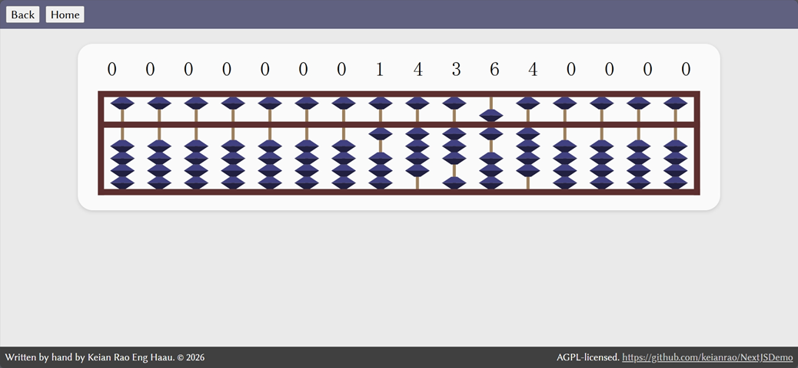
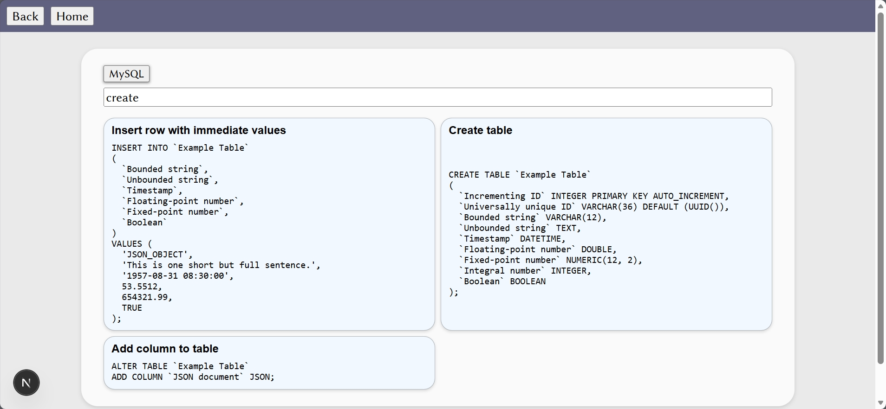
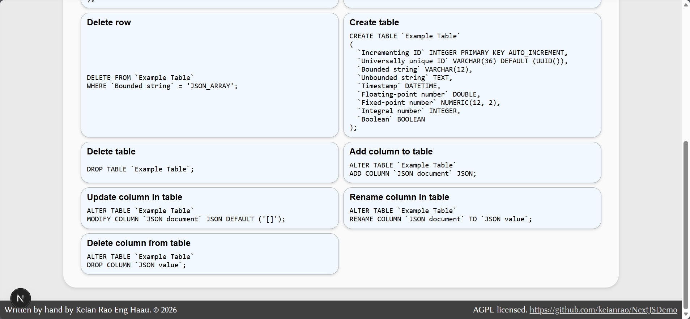

## Introduction

This is a collection of single-file pages, each containing a toy app, with little in common. Unlike my historical JavaScript demos, these pages are all in React, not plain HTML.

## Running the project

This is a Next.js app with commands listed in package.json. `bun dev` will start the development server on port 3000.

The Docker image will be hosted on [Render](https://render.com/login).

## Screenshots

## Creation conditions and project motivation

This project was created just to spend some time to verify that I can put a Next.js app on Github, and possibly set up automatic builds (at least for the Docker image) in the future, when I get around to learning that.

The initial project state was created with a wizard: `bun create next-app` (being run on 28 October 2026, means [version 16.4.3 of the create-next-app NPM package](https://www.npmjs.com/package/create-next-app/v/16.4.3)).

